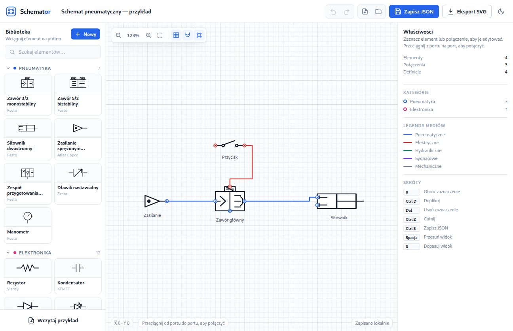

# Schemator

Lekki edytor schematów działający w przeglądarce — napisany w czystym JavaScripcie (ES modules), bez frameworków i bez etapu budowania. Pozwala rysować własne symbole, definiować porty, łączyć elementy i zapisywać całą pracę do pliku JSON, który po ponownym wczytaniu pozostaje w pełni edytowalny.



## Uruchomienie

### Lokalnie (Node.js)

Wymagany jest Node.js 18+ (używany jest wbudowany serwer statyczny).

```bash
npm start
```

Następnie otwórz <http://localhost:5173>. Port można zmienić zmienną środowiskową `PORT`:

```bash
PORT=8080 npm start
```

Nie ma żadnych zależności do instalowania. Aplikacja korzysta z ES modules, więc musi być serwowana przez HTTP — otwarcie `index.html` bezpośrednio z dysku (`file://`) nie zadziała.

### Na serwerze (Apache + PHP)

Wgraj cały katalog na serwer. Stroną startową jest `index.php` (wymaga PHP), a `.htaccess` pilnuje, żeby Apache nie wybrał `index.html`. Node.js nie jest potrzebny. Sposób działania cache opisuje sekcja „Cache plików”.

### Cache plików (ważne przy aktualizacjach)

**Lokalnie (`npm start`)** serwer rozwojowy wysyła `Cache-Control: no-store` i dopisuje do każdego importu oraz do `<script>`/`<link>` parametr `?v=<hash>` liczony z zawartości pliku **razem z jego importami**. Po zmianie dowolnego modułu przeglądarka pobiera świeżą wersję.

**Na Apache + PHP (np. za Cloudflare)** wejściem jest `index.php`. Odczytuje on `index.html` i dokleja do adresów `?v=<time()>` — nową wartość co sekundę:

- `css/app.css?v=...` i `js/main.js?v=...` w znacznikach `<link>`/`<script>`,
- mapa importów (`<script type="importmap">`), dzięki której ten sam parametr dostają wszystkie moduły importowane w środku (`model.js`, `render.js`, `store.js`, ...).

Plik `.htaccess` ustawia `DirectoryIndex index.php` (żeby Apache nie wybrał `index.html`), przepisuje `/index.html` na `index.php` i dodaje nagłówki `no-store` dla HTML/PHP/JS/CSS. Nagłówki wymagają `mod_headers` — jeśli hosting go nie ma, działa samo `?v=<time()>` (a HTML i tak dostaje `no-store` z PHP). Wystarczy wgrać cały katalog na serwer — bez Node.js i bez etapu budowania. Nie trzeba czyścić cache w Cloudflare: każdy adres pliku jest inny, więc Cloudflare pobiera go na nowo. Cloudflare domyślnie nie cache'uje HTML — jeśli masz włączoną regułę „Cache Everything”, wyłącz ją dla `index.php`, inaczej sama strona może przyjść z cache.

W prawym dolnym rogu paska statusu widnieje numer wersji, np. `wersja 1.3.0 · 1734567890` — pierwsza część to wersja aplikacji z `package.json`, druga to parametr `v` aktualnie wczytanych plików (na Apache jest to znacznik czasu `time()`, lokalnie hash). Jeśli po odświeżeniu numer się nie zmienił, na pewno działa stary kod. Kliknięcie tego pola wymusza odświeżenie z pominięciem cache.

## Najważniejsze funkcje

- **Płótno schematu** — przesuwanie i skalowanie (kółko myszy, `Spacja` + przeciąganie, środkowy przycisk myszy), siatka, przyciąganie do siatki, dopasowanie widoku do zawartości. W pasku nad płótnem przełączasz narzędzie: **myszka** (zaznaczanie i edycja, skrót `V`) lub **rączka** (przesuwanie widoku lewym przyciskiem, skrót `H`).
- **Biblioteka elementów** — 93 gotowe symbole w sekcjach: Pneumatyka (15, wg ISO 1219), Elektronika (40), Elektryka (19, wg PN-EN 60617), Hydraulika (18), Schemat blokowy (1). Sekcje są domyślnie zwinięte (rozwija je kliknięcie, a wyszukiwanie rozwija je automatycznie). Wyszukiwanie, miniatury, dodawanie kliknięciem lub przeciągnięciem na płótno.
- **Rozciąganie symboli** — rdzeń transformatora można wydłużać w pionie uchwytem na dolnym brzegu lub polem **Wysokość** w inspektorze (40–600 px). Wysokość jest zapisywana w instancji (`h`), więc po wczytaniu pliku pozostaje bez zmian.
- **Schemat blokowy** — blok funkcjonalny ma 16 węzłów (po 4 na każdym boku). Jego etykieta jest treścią wpisaną w środku pola, a blok automatycznie dopasowuje szerokość i wysokość do tekstu. Połączenia sygnałowe mają groty strzałek wskazujące punkt docelowy.
- **Własne elementy** — kreator rysowania z narzędziami: linia, prostokąt, elipsa, rysunek odręczny, tekst, gumka, zaznaczanie/przesuwanie. Definiowanie portów (medium, kierunek, identyfikator, pozycja, przyciąganie do krawędzi). Zapisz do „Moich elementów”, a później edytuj lub usuń.
- **Połączenia port–port** — przeciągnij od portu do portu. Medium połączenia jest dobierane automatycznie; zgodność mediów portów jest sprawdzana. Połączenia są trasowane ortogonalnie i można je zaznaczać oraz opisywać. Połączenia sygnałowe kończą się grotem strzałki skierowanym w wybrany port.
- **Automatyczne trasowanie przewodów** — trasy omijają obrysy elementów i w pierwszej kolejności unikają skrzyżowań. Jeśli przecięcie jest konieczne, rysowany jest mostek (pętelka), który oznacza, że przewody się nie łączą.
- **Edycja instancji** — etykieta, pozycja X/Y, obrót w krokach 90°, duplikowanie, usuwanie, przesuwanie strzałkami.
- **Undo/redo** — dla operacji na schemacie i w kreatorze elementów.
- **Zapis i odczyt** — pobieranie schematu jako JSON, wczytywanie pliku JSON (także przez upuszczenie na płótno), eksport do samodzielnego pliku SVG.
- **Autozapis** — bieżący schemat i ustawienia są zapisywane w `localStorage`; po odświeżeniu strona wraca do ostatniego stanu. Wyjątkiem jest wbudowany przykład: aplikacja startuje z czystym płótnem, a schemat przykładowy wczytuje się przyciskiem **Wczytaj przykład**.
- **Motyw jasny/ciemny** oraz responsywny układ paneli.

## Sterowanie

| Czynność | Sposób |
| --- | --- |
| Zaznaczenie elementu | kliknięcie |
| Zaznaczenie wielu elementów | `Shift` + kliknięcie lub ramka na pustym płótnie |
| Przesuwanie elementów | przeciąganie (zaznaczone przesuwają się razem) |
| Przesuwanie o siatkę | strzałki (`Shift` = mniejszy krok) |
| Obrót | `R` lub przycisk w inspektorze |
| Duplikowanie | `Ctrl+D` |
| Usuwanie | `Del` / `Backspace` |
| Cofnij / ponów | `Ctrl+Z` / `Ctrl+Y` (lub `Ctrl+Shift+Z`) |
| Zapis JSON | `Ctrl+S` |
| Otwarcie JSON | `Ctrl+O` |
| Dopasowanie widoku | `0` |
| Przesunięcie widoku | `Spacja` + przeciąganie, środkowy przycisk myszy |
| Zmiana skali | kółko myszy lub `+` / `-` |
| Edycja etykiety | dwuklik na elemencie |

## Własne elementy i porty

1. Kliknij **Nowy** w panelu biblioteki.
2. Podaj nazwę, kategorię, opcjonalnie producenta i numer części. Ustaw szerokość i wysokość symbolu.
3. Narysuj grafikę wybranym narzędziem. Prostokąt i elipsa są rysowane od narożnika do narożnika, a rysunek odręczny zapisuje kolejne punkty polilinii.
4. Dodaj porty przyciskiem **Dodaj** (lub narzędziem **Port**), a następnie kliknij na płótnie. Kliknięcie blisko krawędzi przyciąga port do tej krawędzi. W liście po prawej ustaw identyfikator, medium i kierunek (`Wej.`, `Wyj.`, `Dwuk.`).
5. Kliknij **Zapisz element**. Symbol trafi do sekcji **Moje elementy** i będzie dostępny także po odświeżeniu strony.

Kolor portu odpowiada medium. Połączenie można utworzyć tylko między portami o zgodnym medium (wyjątkiem jest medium `other`, które pasuje do każdego). W razie potrzeby medium połączenia zmienisz w inspektorze.

### Kolory mediów

| Medium | Kolor |
| --- | --- |
| Pneumatyczne | niebieski |
| Elektryczne | czerwony |
| Hydrauliczne | zielony |
| Sygnałowe | fioletowy |
| Mechaniczne | szary |
| Inne | łupkowy |

## Format JSON

Schemat jest zwykłym obiektem JSON z trzema głównymi sekcjami: `definitions`, `instances` i `connections`. Taki sam format jest pobierany przyciskiem **Zapisz JSON** i przyjmowany przy wczytywaniu. Do pliku trafiają wyłącznie definicje symboli użytych przez instancje — nie cała biblioteka. Poniższy przykład jest skrócony — pokazuje strukturę i najważniejsze pola; w prawdziwym pliku `data` zawiera pełny SVG, a definicji i instancji jest tyle, ile na schemacie.

```jsonc
{
  "meta": {
    "title": "Schemat pneumatyczny — przykład",
    "version": 1,
    "created": "2026-01-01T10:00:00.000Z",
    "modified": "2026-01-01T10:05:00.000Z"
  },

  // Definicje symboli. Klucz (np. PNEU_SUPPLY) jest identyfikatorem typu.
  "definitions": {
    "PNEU_SUPPLY": {
      "name": "Zasilanie sprężonym powietrzem",
      "category": "pneumatic",
      "manufacturer": "Festo",
      "partNumber": "",
      "width": 80,
      "height": 60,
      "graphic": {
        "format": "svg",
        "width": 80,
        "height": 60,
        // Pełny, samodzielny fragment SVG symbolu (współrzędne 0..width / 0..height).
        "data": "<svg xmlns=\"http://www.w3.org/2000/svg\" width=\"80\" height=\"60\" viewBox=\"0 0 80 60\">…</svg>",
        // Opcjonalny model kształtów — pozwala ponownie otworzyć symbol w kreatorze.
        "model": {
          "shapes": [
            { "type": "line", "x1": 10, "y1": 30, "x2": 55, "y2": 30, "stroke": "#111827", "strokeWidth": 2 }
          ]
        }
      },
      "ports": [
        { "id": "out_1", "type": "pneumatic", "dir": "out", "x": 80, "y": 30 }
      ]
    }
    // … kolejne definicje, np. "PNEU_VALVE_3_2" dla instancji V1
  },

  // Instancje symboli umieszczone na płótnie.
  "instances": [
    {
      "id": "P1",
      "type": "PNEU_SUPPLY",   // klucz z sekcji definitions
      "x": 80,
      "y": 180,
      "rot": 0,               // 0, 90, 180 lub 270
      "h": 160,               // opcjonalne: wysokość symbolu rozciąganego (np. rdzenia)
      "label": "Zasilanie"
    }
  ],

  // Połączenia: "instancja.port" po obu stronach.
  "connections": [
    {
      "id": "c_demo_1",
      "from": "P1.out_1",
      "to": "V1.in_1",
      "medium": "pneumatic",
      "label": ""
    }
  ]
}
```

Ważne zasady:

- `from` i `to` mają postać `ID_INSTANCJI.ID_PORTU`, np. `V1.out_2` lub `V2.in_1`.
- `medium` połączenia to jeden z typów portów: `pneumatic`, `electric`, `hydraulic`, `signal`, `mechanical`, `other`.
- `dir` portu to `in`, `out` lub `bi`.
- `h` jest opcjonalne i występuje tylko przy symbolach rozciąganych (definicja ma wtedy `stretch: { axis: "y", min, max }`). Brak `h` oznacza wysokość domyślną z definicji; wartość jest zawsze ograniczana do zakresu `min`–`max`.
- `category` definicji to `pneumatic`, `electronic`, `electrical`, `hydraulic`, `block` lub `other`.
- `graphic.data` może być pełnym elementem `<svg>…</svg>` albo samym markupem wewnętrznym. Przy wczytywaniu jest on czyszczony z niebezpiecznych elementów i atrybutów, a identyfikatory wewnętrzne są rozdzielane między instancjami.
- Niepoprawne referencje (np. połączenie do nieistniejącego portu) są pomijane z ostrzeżeniem, ale reszta dokumentu wczytuje się poprawnie.

## Dane lokalne

W `localStorage` przeglądarki przechowywane są:

| Klucz | Zawartość |
| --- | --- |
| `schemator.doc.v1` | ostatnio edytowany schemat (autozapis) |
| `schemator.library.v1` | własne elementy („Moje elementy”) |
| `schemator.settings.v1` | motyw, siatka, przyciąganie, widoczność portów |

Wyczyszczenie tych kluczy w narzędziach deweloperskich przywraca stan początkowy. Aby zachować schemat na stałe, użyj **Zapisz JSON**.

## Struktura projektu

```
index.html          # szkielet aplikacji (szablon; lokalnie i jako baza dla index.php)
index.php           # wejście produkcyjne: index.html + ?v=<time()> dla CSS i modułów
.htaccess           # Apache: DirectoryIndex index.php + nagłówki no-store
css/app.css         # motywy, układ, style płótna i kreatora
js/main.js          # start aplikacji i akcje (nowy, otwórz, zapisz, eksport)
js/model.js         # model dokumentu, normalizacja, geometria portów i tras
js/render.js        # renderer SVG, siatka, miniatury, eksport SVG
js/canvas.js        # interakcje płótna: zaznaczanie, przesuwanie, łączenie, zoom
js/editor.js        # kreator własnych elementów i portów
js/panels.js        # biblioteka, inspektor, skróty klawiszowe
js/library.js       # wbudowane definicje i schemat demonstracyjny
js/libraryStore.js  # trwałość i scalanie biblioteki użytkownika
js/store.js         # stan dokumentu, historia, zaznaczenie, autozapis
js/utils.js         # pomocnicze funkcje, sanityzacja i parsowanie SVG
js/ui.js            # toasty i status zapisu
server.mjs          # lokalny serwer statyczny (tylko do pracy nad projektem)
```

## Uwagi

- Aplikacja jest zaprojektowana pod nowoczesne przeglądarki (Chrome, Edge, Firefox, Safari) z obsługą ES modules, SVG i `structuredClone`.
- Eksport SVG zawiera symbole i połączenia, ale nie zawiera interaktywnych portów ani siatki — jest przeznaczony do dokumentacji i druku.
- Wbudowane symbole są tylko do odczytu. Aby zmienić grafikę, utwórz własny element; własne elementy można później edytować bezpośrednio z biblioteki.
